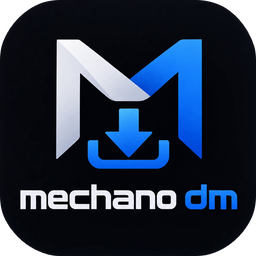

# Mechano Download Manager (MDM)

An IDM-style download manager for Windows: multi-connection downloads, resume, video downloads from
YouTube, Facebook, Instagram, TikTok and more, a scheduler and a Chrome / Edge button on videos.

<p align="center"></p>

## Download

**[⬇ Mechano DM Setup.exe](../../releases/latest)** (one file, about 90 MB). Everything is inside: Node.js, yt-dlp and ffmpeg.

1. Double-click **Mechano DM Setup.exe**, then click **Install**. It needs no admin rights and no internet to install.
2. Click **Finish**, and Mechano DM opens.
3. For the Download button on videos, click **Add the Download button to Chrome / Edge** on the last screen and follow the 3 steps.

If Windows shows "Windows protected your PC", click **More info**, then **Run anyway**. The app isn't signed with a paid certificate.
To remove it: **Settings → Apps → Mechano Download Manager → Uninstall**. Your downloaded files stay where they are.

> **بالعربي:** حمّل `Mechano DM Setup.exe` من [Releases](../../releases/latest)، دبل كليك ← **Install** ← **Finish**، والبرنامج يفتح على طول.
> مش محتاج تحمّل أي أداة تانية، ولا محتاج صلاحيات أدمن.

## Features

- **Multi-connection downloads** with IDM-style *dynamic segmentation*: each free connection splits the largest remaining part (up to 32 connections).
- **Pause / resume**, even after closing the app or restarting the PC.
- **YouTube, Facebook, Instagram, TikTok, X, Vimeo, Reddit and more** through yt-dlp, with a quality choice. Saved as MP4 (H.264 + AAC), which plays everywhere.
- **Whole playlists**: a "Videos" panel shows the current video, and you can skip or re-order videos.
- **Floating "New download" window** with quality and save folder, and a **"Download complete"** popup with *Open* / *Open folder*.
- **Scheduler and queue** like IDM: start time, days of the week, "N files at the same time", re-ordering. After it finishes the app can sleep, hibernate, restart or shut down the PC.
- **HLS streams** (`.m3u8`) with AES-128, plus a speed limit and category folders (`Downloads\M.DM\Video`, `Music`, …).
- **yt-dlp updates itself** every 5 days, or press ⟳.
- **Light / dark themes**, tray icon, start with Windows, and its own taskbar icon.
- **Browser extension** (Chrome / Edge): a Download button on videos, download takeover, and right-click "Download with Mechano DM".

## Build from source

Needs Windows 10/11 and Node.js 20+. The engine has no npm dependencies.

```bash
node --test test/
```

```bash
desktop\build-exe.cmd
```

`build-exe.cmd` builds `Mechano DM.exe` (the Windows window) with the C# compiler that comes with Windows.
Put `yt-dlp.exe` and `ffmpeg.exe` in `bin\` (or install them with `winget install yt-dlp.yt-dlp`), then run `Mechano DM.exe`.

To build the one-file installer (`dist\Mechano DM Setup.exe`) and the portable zip:

```bash
powershell -ExecutionPolicy Bypass -File build-setup.ps1 -Rebuild
```

### Project layout

| Path | What it is |
|---|---|
| `desktop/MechanoDM.cs` | The Windows app: tray, main window (WebView2), floating windows. It runs the engine. |
| `desktop/Setup.cs` | The installer / uninstaller (LZX cabinet unpacked with Windows' setupapi). |
| `src/` | Engine (Node.js): `segmented.js` multi-connection, `hls.js`, `ytdlp.js`, `playlist.js`, `manager.js` queue, `scheduler.js`, `updater.js`, `server.js` local API. |
| `ui/index.html` | The app's interface. |
| `extension/` | Chrome / Edge extension (Manifest V3). |
| `test/` | Offline tests (`node --test test/`). |

### Security

The local API listens on `127.0.0.1` only. Every request needs a private token that each PC creates on first run. A Host-header check blocks DNS rebinding, and only the browser extension can pair.
Cookies a download needs are kept only for that download, then deleted.

## Legal

- Download only content you have the right to save: your own files, public-domain or Creative Commons media, or anything the site's terms allow.
- **DRM-protected media** (Netflix, Disney+, Spotify, Widevine/FairPlay, SAMPLE-AES) is detected and refused. MDM does not bypass DRM.
- Code: [MIT License](LICENSE). The Setup bundles Node.js (MIT), yt-dlp (Unlicense) and FFmpeg (GPL), each with its license.
